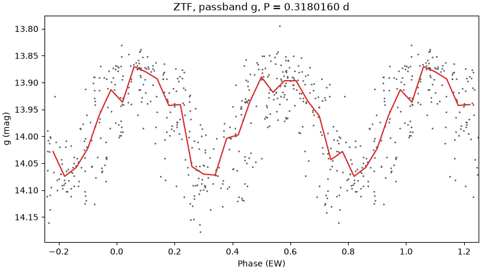

# 2. The problem Argelander addresses

## How VSX grew

VSX began as a merger of the old hand-curated catalogues, the General Catalogue of
Variable Stars and its supplement, where every entry had been examined by a person. What
made it two million entries was the sky surveys of the last twenty-five years. Each one,
ASAS, NSVS, LINEAR, the Catalina surveys (CSS), ASAS-SN, ZTF, Gaia and others, photographed
the whole sky it could see over and over, ran software over the millions of resulting light
curves, and published a catalogue of the stars the software called variable, with a period
and a type for each. VSX imported those catalogues in bulk. The star names in this guide
are those surveys' names: `CSS_J181701.4+514940` is a Catalina discovery at those
coordinates, `ASASSN-V J164537.58+592828.7` an ASAS-SN one.

A bulk import is the only way to get a million stars into a catalogue, and the surveys'
periods are right far more often than not. But the period and type in a bulk-imported
entry are whatever one survey's software found, in one survey's data, usually with no
person looking at that star. Three things go wrong with that often enough to matter.

## The 1-day alias

The software finds a period by computing a **periodogram**: for every trial period it
asks how well a repeating signal at that period fits the data, and reports the best.
Chapter 3 shows what one looks like. The weakness is in what the data cannot say.

A ground-based survey observes a star at most once or twice a night, because for the
rest of the day the Sun is up. So its measurements are spaced at multiples of a day, and a
star that completes, say, 3.24 cycles in a day looks exactly like one that completes 2.24
or 4.24 cycles in a day: at each nightly visit, both have advanced by the same fraction of
a cycle. These are **aliases** of each other, separated by one cycle per day. A periodogram
of such data shows a peak at the true frequency and peaks almost as tall at the true
frequency plus and minus one cycle per day, and which is tallest is partly luck. Software
that takes the tallest peak picks the alias some fraction of the time.

`CSS_J181701.4+514940` is one of those. VSX gives it 0.446574 days, from the Catalina
catalogue. In cycles per day that is 2.2393. Gaia, which observed from space on its own
irregular schedule and has no 1-day sampling, finds 0.308582 days, or 3.2406 cycles per
day. The difference is 1.0013 cycles per day: the published value is the 1-day alias of
the true one.

Folded at the published period, the ZTF measurements do not line up:

Folded at the true period, they trace an eclipsing binary:

There are two other sampling aliases the pipeline always tests. The *sidereal* day,
0.99727 days, is the Earth's rotation relative to the stars rather than the Sun, and it
is the interval at which a survey telescope returns to the same patch of sky. The half
day shows up when a survey visits twice a night.

## Half periods and double periods

The periodogram is looking for one up-and-down per cycle. An eclipsing binary dips twice
per orbit, at the primary and the secondary eclipse, and when those dips are similar the
periodogram's best fit is a signal with half the orbital period, which fits both dips at
once. So a pipeline that reports the periodogram peak reports half the period of every
`EW` binary, and VSX's own type document warns of a whole class of entries, the ASAS-3
`DSCTr` stars, that "are actually contact binaries with twice the period given". The
reverse happens too: a sinusoidal pulsator can be mistaken for an ellipsoidal binary with
twice the period.

`CSS_J181701.4+514940` shows both problems at once. Its periodogram peak is at 0.154292
days, half the true period, because the two eclipses fold onto each other there:

Only at 0.30858 days do the two dips per cycle appear, and two dips where a pulsator has
one say *binary*. Settling P against 2P is the job of the alias test in chapter 3.

## Neighbouring stars blend into each other

A survey measures a star through an aperture of some size on the sky, and at 13–16 mag
that aperture often holds more than one star. Catalina's pixels are 2.5 arcseconds across;
ASAS-SN measures through a 17-arcsecond aperture; TESS's pixels are 21 arcseconds. (An
arcsecond is 1/3600 of a degree; the full Moon is 1,800 of them across.) When a variable
star and a constant one sit within an aperture of each other, the variability is measured
on both, and software that does not know which is which can attribute it to the wrong
star. The result is an entry whose period is real, whose light curve is convincing, and
whose position is the neighbour's.

`CSS_J160212.7+530724` is one. Its VSX position lies on a Gaia source that Gaia does not
consider variable. 1.2 arcseconds away is a star two magnitudes brighter that Gaia's own
variability pipeline classes as an eclipsing binary with the same period VSX publishes for
the fainter one. Folded at the VSX period the fainter star's ZTF measurements make a
perfectly good contact-binary curve:

Nothing in that plot says the light belongs to the neighbour. Only the catalogue of
positions does.

## Types assigned from the period alone

Survey software usually assigns a type from the period, the amplitude and the shape of
the folded curve. That is good enough for a clear `RRAB` or a deep `EA`, but an `EW`
binary and an `RRC` pulsator of the same period can have nearly the same shape, and a
period off by a factor of two moves a star from one type's range into another's. A wrong
period and a wrong type tend to arrive together.

## Why it matters, and what Argelander does about it

An entry with the alias period, or with half the period, or with the right period on the
wrong star, is not useless. But everyone downstream builds on it: the observer folds their
own data at the wrong period and sees noise, the researcher's cross-match attaches the
wrong physics, and the next survey's software, trained on the catalogue, learns the
mistake. VSX's moderators correct such entries as evidence reaches them, one at a time.

Argelander produces that evidence systematically, for one Slice of sky at a time, and
holds itself to rules stricter than the bulk imports did:

1. **More than one survey.** A period is accepted only when two independent sources find
   it after their aliases have been tested, not when one periodogram's tallest peak says
   so. This is [Agreement](../../CONTEXT.md#analysis).
2. **Every alias tested.** 2P, P/2, the 1-day, half-day and sidereal-day aliases are each
   folded and scored before any period is believed.
3. **Every aperture checked.** Each survey's photometry is judged against its own aperture
   and the Gaia sources inside it, and a survey that may be measuring a neighbour counts
   for half.
4. **A physical sanity check.** The star's colour and distance from Gaia put it on the
   colour-magnitude diagram, where a pulsator and a binary live in different places.
5. **A person decides.** The pipeline proposes; Tom reviews; a moderator judges. Nothing is
   submitted automatically.

Chapter 3 is about reading what those rules produce.
