# 3. How to read the evidence

The pipeline takes one [Target](../../CONTEXT.md#selection) through a fixed order of
steps, and each step leaves something a person can look at. The review app (milestone 6)
will show these same files for every [Proposal](../../CONTEXT.md#proposals-and-review);
until then the walkthrough notebook writes them. The figures below are those files, for
the three stars of [`notebooks/02_guide_one_star.ipynb`](../../notebooks/02_guide_one_star.ipynb):
V0364 Dra, an RR Lyrae star everything agrees on; CSS_J181701.4+514940, the alias from
chapter 2; and CSS_J160212.7+530724, the blend.

The steps, in the order the pipeline runs them:

1. [The four surveys](#31-the-four-surveys-and-what-each-can-and-cannot-see) · `combined.png`
2. [Cleaning](#32-cleaning)
3. [The periodogram](#33-the-periodogram) · `periodogram.png`
4. [Aliases and folding](#34-aliases-and-folding) · `phase-<survey>-<band>.png`
5. [Agreement](#35-agreement) · the votes
6. [Blends and contamination radii](#36-blends-and-contamination-radii) · the flags and remarks
7. [The colour-magnitude diagram](#37-the-colour-magnitude-diagram) · `cmd.png`
8. [What goes to VSX](#38-what-goes-to-vsx) · `submission.png`

## 3.1 The four surveys, and what each can and cannot see

A [Light Curve](../../CONTEXT.md#evidence) is one survey's measurements of one star in
one passband: a list of times and brightnesses. Argelander fetches up to four surveys per
Target into the [Cache](../../CONTEXT.md#evidence), and each sees something the others
cannot.

| Survey | What it is | Bands | Cadence and span | Aperture | Useful range | Good at | Weak at |
| --- | --- | --- | --- | --- | --- | --- | --- |
| **ZTF** | A 1.2 m telescope at Palomar, California, imaging the northern sky since 2018 | g, r (sometimes i) | Every night or two; 7 years so far | 1″ pixels, ~2″ | 13–21 mag | Long baseline, hundreds of points, two colours; resolves periods to a part in ten thousand | Once a night, so 1-day aliases; saturates brighter than ~13 |
| **TESS** | A NASA space telescope that stares at one patch of sky for 27 days at a time, since 2018 | one broad red band, as flux | Every 2 to 30 minutes for 27 days per sector | 21″ pixels, ~120″ | brighter than ~15 | Continuous, so no daily aliases; nails short periods and eclipse shapes | Enormous pixels, so nearly every 13–16 mag star is blended; 27 days is too short for long periods; faint stars are noisy |
| **Gaia DR3** | ESA's astrometry mission; a scan of the whole sky, 2014–2017 | G, BP, RP | A few dozen visits over 34 months | 0.7″ | 5–21 mag | Precise positions, so it finds neighbours; parallax and colour for the CMD; its own published period for many stars | Too few visits to settle a period from its photometry alone |
| **ASAS-SN** | Small telescopes on several continents imaging the whole sky nightly since 2012 | V (to 2018), g (since 2017) | Nightly; 12 years | 8″ pixels, 17″ aperture | 10–16.5 mag | The longest baseline, and the V band VSX prefers for ranges | Coarse pixels, so blends within 17″; our Slice is at its faint end |

ASAS-SN is absent from every figure in this guide. Its light-curve service was down while
the fixtures were built, and NEU-1796 adds it. When it arrives it will be one more series
on the combined plot, one more panel on the periodogram, and one more vote in Agreement,
and V-band ranges for the form.

**The combined light curve** (`combined.png`) is the first thing to look at: every survey
on one time axis. The horizontal axis is time in days (BJD_TDB, the time system every
survey is converted into, minus 2,400,000 so the numbers are readable), the vertical axis
is magnitude with *brighter up*, and each survey has its own marker. TESS measures flux,
not magnitude, so it is drawn as the change in magnitude from its own median and shifted
to the level of the others. Here is V0364 Dra:

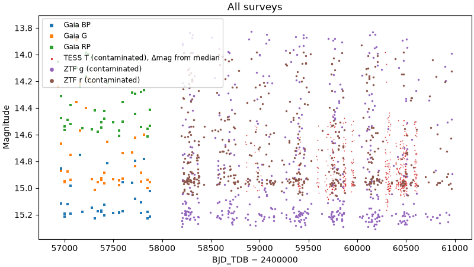

What to notice: ZTF (circles) spans the whole seven years; TESS (dots) comes in dense
clumps, one per 27-day sector, in the years it happened to point this way; Gaia (squares)
is a sprinkle of points in 2014–2017. The star scatters over about a magnitude at every
epoch, which is the pulsation seen without a period. The legend already says
*(contaminated)* against ZTF and TESS; section 3.6 explains what that means for this
star. VSX asks for exactly this plot with a data-mined submission, and forbids one copied
from a survey's website.

## 3.2 Cleaning

Before any search, each Light Curve is cleaned (`analysis/clean.py`):

1. Points the survey itself flagged as bad are dropped.
2. Points more than 5σ from a running median of their neighbours are dropped, but only
   where the neighbours are within seven minutes of the point. In practice that is only
   TESS's fast cadence; on ZTF, Gaia and ASAS-SN the neighbours are at unrelated phases, so
   clipping against them would throw away every eclipse.
3. A band needs 30 surviving points to be searched at all.

On the committed fixtures nothing is clipped, because they are trimmed to 500 points a
band and no two TESS points are close enough; on a full TESS sector it matters. The
notebook prints the before-and-after count per band. For V0364 Dra every band survives:
ZTF g and r with 500 points each over 2,770 days, TESS with 500 from sectors spread over
1,770 days, and Gaia's three bands with 32 to 41 points over 900 days.

## 3.3 The periodogram

A **periodogram** asks, for every trial period on a fine grid from 0.05 to 100 days, how
much of the star's variation a repeating signal at that period would explain, and plots the
answer as *power* against period. A tall, narrow peak means one period explains the data
far better than its neighbours; a forest of peaks of similar height means the data do not
single one out.

Two searches run on every band (`analysis/periodogram.py`). **Lomb-Scargle** fits a
sinusoid at each trial period and suits pulsators and anything smooth. **Box least
squares** (BLS) fits a flat line with a box-shaped dip, which is what an eclipse looks
like, and suits detached binaries that Lomb-Scargle smears out. Each keeps its five
highest peaks, with a *false-alarm probability* for Lomb-Scargle: the chance that noise
alone would produce a peak that tall.

`periodogram.png` stacks one panel per band and method, period on a logarithmic axis.
Three kinds of line mark it: a solid red line at the period the pipeline settled on, dashed
orange lines at the aliases of that period the alias test tried, and a dotted blue line at
Gaia's published period, which is scored in every band whether or not the periodogram
found it.

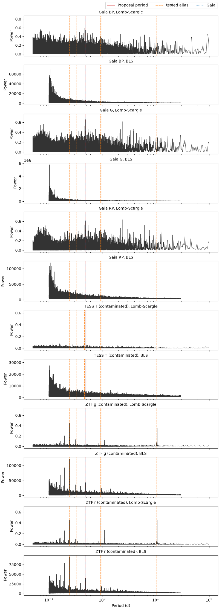

What to notice for V0364 Dra: the same tall peak at 0.477 days in ZTF g, ZTF r and TESS,
with the Gaia line on top of it. Now look at the dashed lines in the ZTF panels: there is
a peak under every one of them. At 0.32 days and 0.24 days, at 0.95 days, even at 10
days, the same pulsation shows up wherever once-a-night sampling can put it, and the
0.32-day peak is nearly as tall as the real one. This is chapter 2's alias problem in a
picture, and the periodogram alone cannot settle it; the next step does, by folding, and
the fold at 0.3227 days scores 0.45 against 0.04 at 0.477 days. Gaia's own three bands,
with 32 to 41 points, are a forest of peaks of similar height, which is why Gaia's
photometry never decides a period on its own.

Now the alias star:

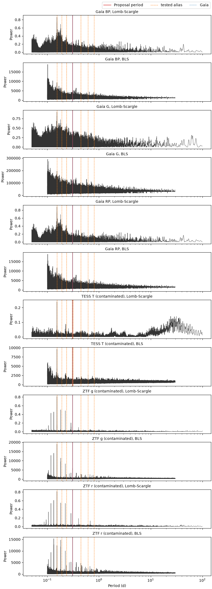

What to notice: the tallest Lomb-Scargle peak in every band is at 0.154 days, half the
period, for the reason in chapter 2; the red line at 0.3086 days sits on a smaller peak;
and the dashed line near 0.446 days, where VSX's value lies, has a small peak under it
too. Even Gaia's sparse photometry peaks at 0.154 days. The periodogram alone cannot
choose between them. That is the next step's job.

## 3.4 Aliases and folding

**Folding** is the test of a period. Take each measurement's time, subtract a reference
time, divide by the trial period and keep only the fractional part. That is the
measurement's **phase**: where in the cycle it fell, from 0 to 1. Plotted against phase,
measurements from years apart land on top of one another *if the period is right*, and
the star's cycle appears as a single curve. If the period is wrong, the points smear into
a band. No other check is as direct.

The alias test (`analysis/aliases.py`) folds every band at every candidate the periodograms
and Gaia put forward, and at each candidate's aliases: twice it, half it, and its 1-day,
half-day and sidereal-day aliases (for TESS also the 13.7-day alias of the spacecraft's
orbit). Each fold is scored by its **scatter**: the spread of the points inside narrow
phase bins compared with the spread of all the points. A perfect fold scores near 0, and a
fold no better than no period at all scores 1. The score also charges for the number of
bins, so a longer period, which gets more bins, has to earn them by folding more cleanly;
without that charge every eclipsing binary would settle at half its period. The lowest
score wins, and the whole ranking is kept.

For CSS_J181701.4+514940, the notebook prints ZTF g's ranking. The true period and its
half take the top places with scatter around 0.17, and VSX's 0.4466 days, tried as the
1-day alias of the true one, scores 0.97: no better than no period at all. The three
folds, of the same 500 ZTF g points, are the whole argument in pictures:

| At VSX's 0.446574 d | At the peak, 0.154292 d | At the agreed 0.3085835 d |
| --- | --- | --- |
| 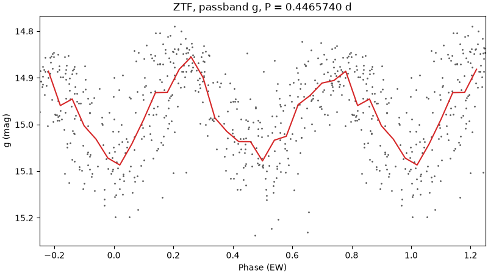 | 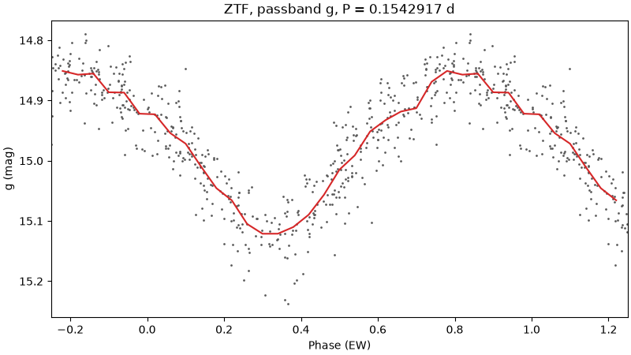 | 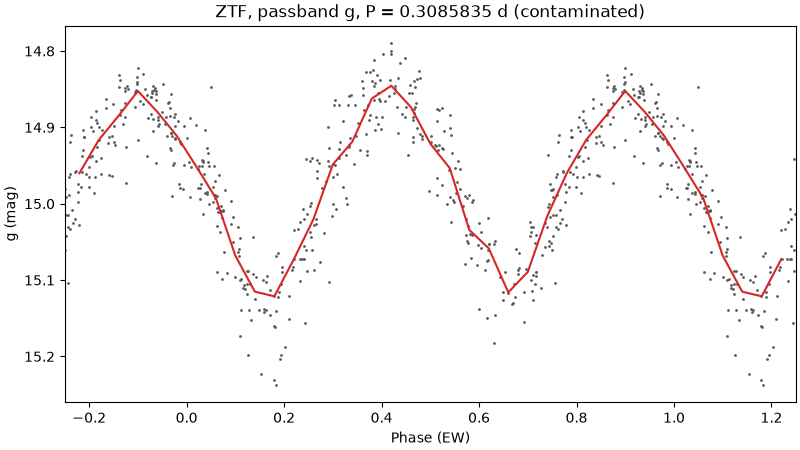 |

Left: the points fill the plot at every phase and the median line wanders through them
with no shape the eye would trust. An alias fold is rarely pure noise, because the points
still half-cohere, which is exactly why a periodogram gives it a peak; but it does not
hold. Middle: a clean curve with one dip per cycle, because the two eclipses are on top of
each other. Right: two dips per cycle, as alike as a contact binary's are, which is the
star seen whole.

**The phase plots** (`phase-<survey>-<band>.png`, one per band) are folds at the period
the pipeline settled on. Read them like this:

- The grey points are the measurements; the red line is the median in each phase bin,
  the curve the magnitude range is read from.
- Phase 0 is the Proposal's epoch: the time of maximum for a pulsator, of primary minimum
  for an eclipsing binary. The axis runs −0.25 to 1.25 for eclipsing binaries and
  ellipsoidal variables, so the primary eclipse is at 0 and 1 and the secondary at 0.5,
  and 0 to 2 for pulsators, rotators and everything else, so a maximum sits in the middle. Two cycles are shown so that nothing important falls on an
  edge. The notebook's folds have no epoch yet, so their phase 0 is simply the first
  observation and the minima fall wherever they fall.
- The title gives the survey, the passband as the VSX form names it, and the period to as
  many decimals as the data's span can justify. A survey the blend check flagged says
  *(contaminated)*.

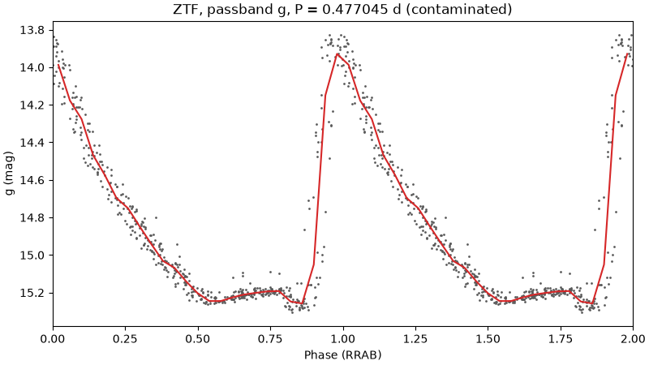

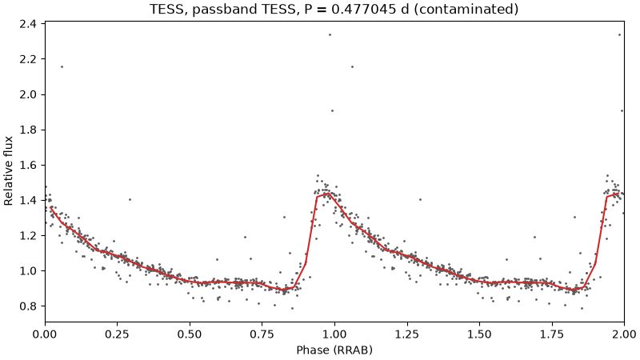

What to notice for V0364 Dra: the steep rise and slow decline of an `RRAB` star, the same
in both. ZTF's points come from seven years and still fold onto one curve, which pins the
period to six decimals. TESS's come from a few 27-day sectors and show the shape in finer
detail, with the scatter of a faint star in large pixels and a few wild points the
trimmed fixtures were too sparse to clip.

## 3.5 Agreement

No single survey settles a period. [Agreement](../../CONTEXT.md#analysis)
(`analysis/agreement.py`) is the rule: at least two independent **sources** must find the
same period after their alias tests. The sources are ZTF g, ZTF r, ASAS-SN, TESS, and
Gaia's published period. Gaia's own photometry does not vote, because a few dozen points
cannot settle a period. ASAS-SN's V and g count as one source, because one instrument
puts the same aliases into both.

Each source votes with the period its alias test ranked first. The rules on the votes:

- **A band that found nothing does not vote.** If its best fold still scores above 0.75,
  it has no period to offer. This is what keeps constant stars out: their ZTF bands both
  "find" the sidereal half-day and would agree on it, at scatter 0.82 to 0.99.
- **Two votes agree** when they are within 0.1 % of each other, or within the period
  divided by the data's span when that is wider, because a periodogram peak cannot be
  narrower than one cycle over the whole baseline. At 50 days that is 2 %.
- **Half and double count.** If some sources found P and others P/2, that is a *2:1*
  Agreement, and the longer period wins, because it is the one that separates an eclipsing
  binary's two eclipses. The relation is recorded for the classifier.
- **A contaminated source counts half** (section 3.6).
- **The period most sources found wins; a tie is no Agreement.** When two periods have
  equal weight, nothing is accepted. The bulk imports' rule, take the tallest peak, is
  exactly what this refuses to do.

For V0364 Dra the notebook's votes table reads: TESS 0.477045, ZTF g 0.477041, ZTF r
0.477038, Gaia 0.477059, all within 0.1 %; Agreement at 0.4770454 days, relation 1:1. The
star is settled four ways.

For CSS_J181701.4+514940: ZTF g, ZTF r and TESS each vote 0.154292 days, Gaia 0.308582;
Agreement at 0.3085835 days, relation 2:1. Three surveys found the half period and Gaia
the whole, and the rule took the whole.

The review app's evidence page will list the votes this way; in the notebook, look for
the table after each star's **Agreement** heading.

## 3.6 Blends and contamination radii

A convincing period that belongs to the wrong star is the failure the surveys could not
catch, so the pipeline judges each survey against its own aperture
(`analysis/blend.py`), using the radii VSX publishes for contamination and the Gaia
sources inside them:

| Survey | Radius checked | Flagged when |
| --- | ---: | --- |
| ZTF and Gaia | 3″ | A Gaia source within 3″ is brighter than the Target + 2 mag. (ZTF also: its separate fields' zero points disagree by more than 0.05 mag.) |
| ASAS-SN | 17″ | A Gaia source within 17″ is brighter than the Target + 2 mag. |
| TESS | 120″ | Any source within 120″ is brighter than the Target + 1 mag, or all of them together carry more than half the Target's light. |

A flagged survey is not thrown away. It still runs through the periodogram and the alias
test, but it **counts half** in Agreement, its plots are titled *(contaminated)*, and the
Proposal carries a sentence for VSX's Remarks field in the shape the VSX FAQ asks for, for
example:

> ZTF magnitudes contaminated by Gaia DR3 1404819652890360064 (G= 13.8; sep. 1.2"). Range not corrected.

The notebook prints each star's flags, remarks and the share of the aperture's light that
is not the Target's, with the table of Gaia neighbours within 20″ and the count of sources
in the TESS field.

CSS_J160212.7+530724 is the case the rule exists for. The neighbour at 1.2″ is 1.9 mag
brighter, so ZTF, Gaia and ASAS-SN are all flagged, and the TESS field is flagged on its
own account. The flags come from the Gaia catalogue, not from the survey's data, which is
why ASAS-SN is flagged although no ASAS-SN Light Curve exists yet. ZTF g, ZTF r and TESS all vote 0.159 days, which would be an easy Agreement,
but at half weight each they add up to 1.5 of the 2 required. No Agreement, no phase plot,
no period proposed.

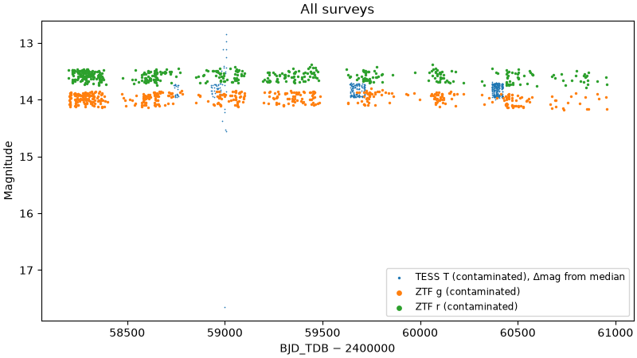

What to notice: the star looks like a perfectly good variable. But read the magnitude
axis. Gaia puts this star at G = 15.7, and ZTF reports it at 13.6 to 14.1: ZTF's aperture
is measuring mostly the neighbour. That is the one hint in the light curve itself; the
rest is the catalogue of positions saying whose light it is.

Two honest caveats about the TESS and ZTF flags, which chapter 4 returns to. TESS's
120″ aperture holds other stars for 25 of the 27 gate stars, so `tess_contaminated` is
nearly always on at 13–16 mag; it means *weigh TESS with care*, not *TESS is wrong*. And
the ZTF zero-point rule fires on 11 of the 20 known-good stars, including V0364 Dra, none
of which has a neighbour within 3″; it is reacting to the star's own variability, and
NEU-1798 corrects it. Until then, a ZTF `blend_suspect` without a neighbour in the table
is a false alarm.

## 3.7 The colour-magnitude diagram

Gaia gives every Target two numbers that have nothing to do with its light curve: a
**parallax**, the tiny annual wobble in its position that gives its distance, and a
**colour**, BP−RP, the difference between its brightness in a blue and a red band, which
gives its surface temperature. Distance turns the apparent magnitude into an **absolute**
one, how bright the star really is. Plotting absolute magnitude against colour gives the
colour-magnitude diagram (`analysis/cmd.py`), the astronomer's map of what kind of star a
thing is:

- the **main sequence**, the diagonal band where stars spend most of their lives, with
  most contact binaries and spotted stars;
- the **giant branch**, bright and red, where Cepheids and the semiregular variables live;
- the **instability strip**, a near-vertical band above the main sequence, where every
  RR Lyrae and δ Scuti star is found;
- **white dwarfs**, faint and blue.

`cmd.png` draws the Target as a red star on a grey background of ordinary Gaia stars,
with the region it fell in:

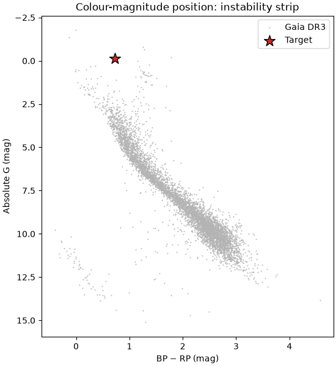

What to notice: V0364 Dra lands on the instability strip, at an absolute magnitude near
0, which is where an RR Lyrae star must be. A star with an RR Lyrae light curve that landed
on the main sequence would be a contradiction worth a hard look. CSS_J181701.4+514940, a
contact binary, lands on the main sequence:

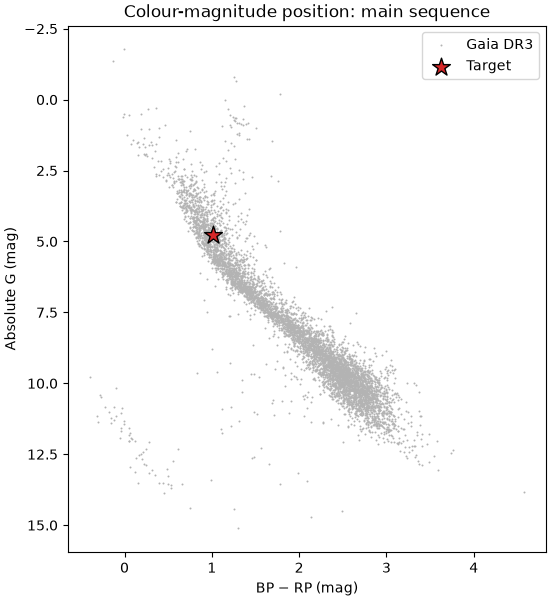

The region is *unknown* when Gaia's parallax is too uncertain to give a distance or the
colour is missing, as it is for the blend star. The regions are coarse polygons and the
colours are not corrected for interstellar dust, which Draco, far from the Milky Way's
plane, has little of. Treat the diagram as a sanity check, not a classification. Across
the 27 gate stars it sorts cleanly: seven of the eight pulsators on the instability strip
(the eighth has no usable parallax), every eclipsing binary and rotator on the main
sequence, the Cepheid and both semiregulars on the giant branch.

## 3.8 What goes to VSX

`submission.png` is the one image the revision form accepts: the phase plot of the band
with the most points (or the one the Review chooses) above the combined light curve,
rendered under the form's 1 MB limit.

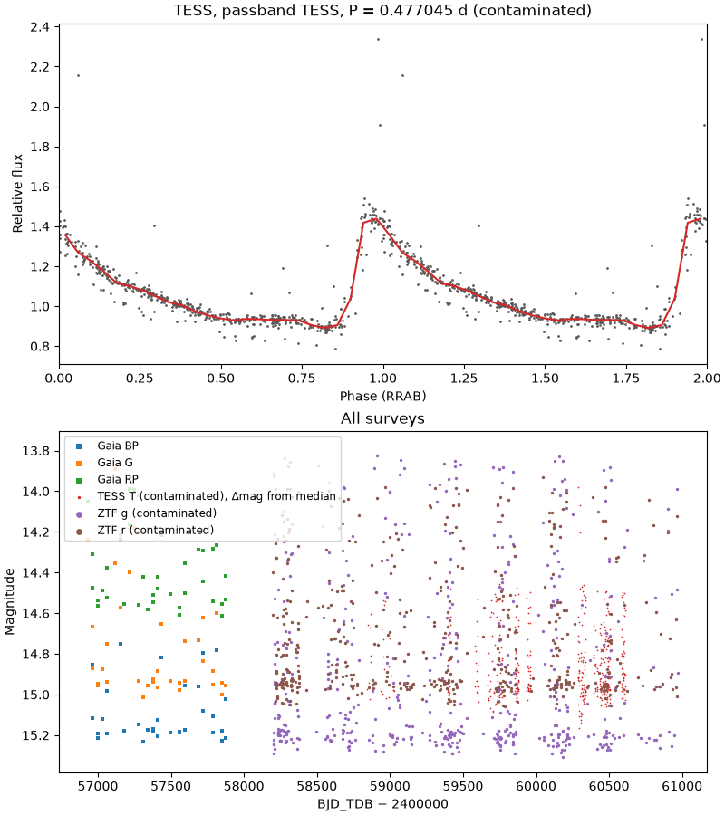

Alongside it the Proposal carries the form's fields, in the vocabulary of
[`docs/reference/vsx-revision-form.md`](../reference/vsx-revision-form.md): the period to the
precision the data justify, the epoch in HJD, the type, the magnitude range at maximum and
minimum in a named passband read from the binned curve, and the Remarks sentences for any
contamination. A Target with no Agreement gets `submission.png` as the combined light
curve alone and a Proposal of type `VAR` with low Confidence, so that the failure is
visible rather than silent.

Chapter 4 is about how far all of this can be trusted.
